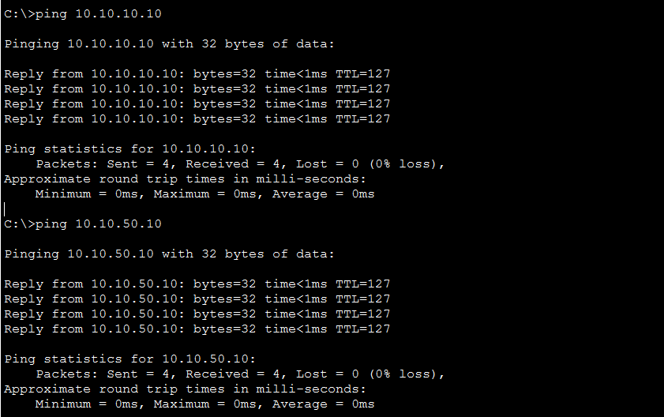
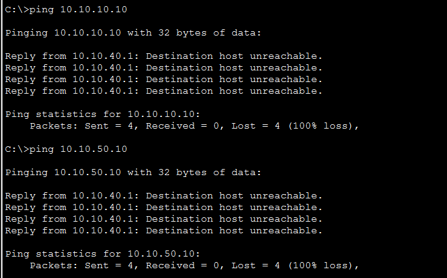
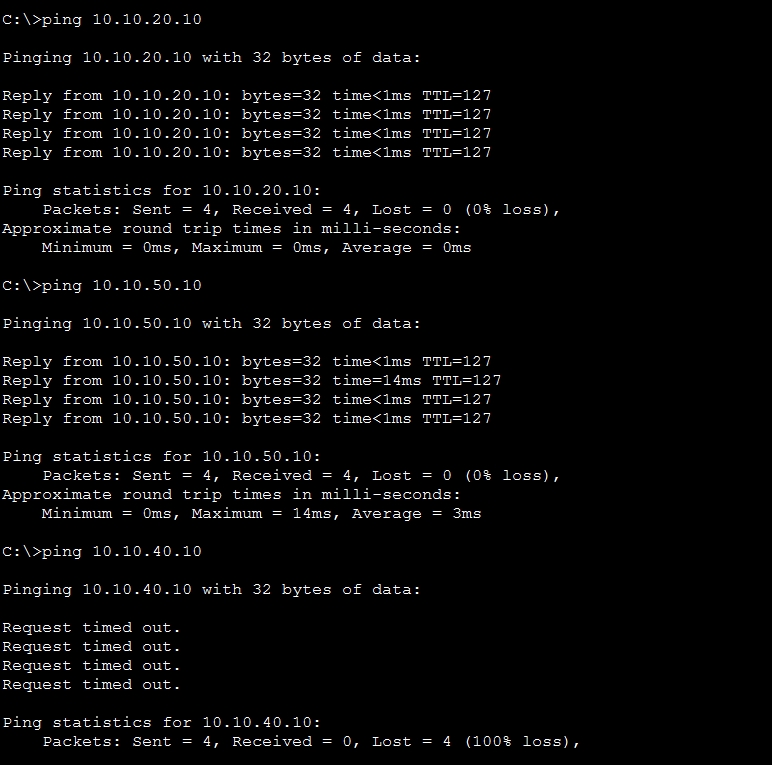
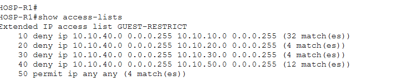
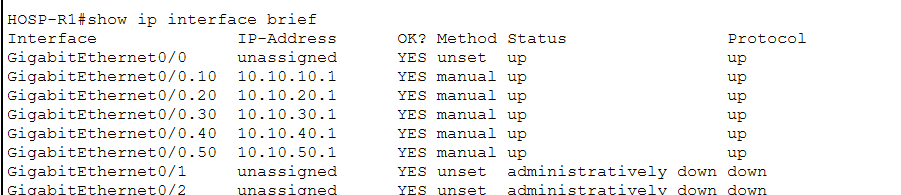

# Project 1: Secure Hospital Network Design (Cisco Packet Tracer)

A simulated hospital network with five VLANs, router-on-a-stick inter-VLAN routing, a guest network isolated by an access control list (ACL), and unused switch ports disabled.

This is the first project in a four-part portfolio that follows one scenario: design the network, investigate its traffic, monitor it, then investigate and respond to security incidents.

> This is a lab simulation. No real patient data or real hospital systems are involved.

---

## Goals

- Separate hospital departments into their own VLANs.
- Route traffic between VLANs using one router link.
- Keep the guest network away from internal systems.
- Reduce the attack surface by disabling unused ports.
- Verify every change with tests, and keep the evidence.

## Tools

- Cisco Packet Tracer (Windows)
- Devices: Cisco 2911 router, Cisco 2960-24TT switch, 4 PCs, 1 end device acting as the server

---

## Topology

| Device | Role | Connects to |
|--------|------|-------------|
| `HOSP-R1` (2911) | Router, gateway for all VLANs | `Gig0/0` to `HOSP-SW1` `Gig0/1` |
| `HOSP-SW1` (2960) | Layer 2 switch | Router trunk plus five access ports |
| `ADMIN-PC` | Administration | `Fa0/1` |
| `DOCTOR-PC` | Doctors | `Fa0/2` |
| `NURSE-PC` | Nurses | `Fa0/3` |
| `GUEST-PC` | Guest Wi-Fi (simulated) | `Fa0/4` |
| `SERVER1` | Servers | `Fa0/5` |


---

## Addressing plan

The VLAN number is used as the third octet, so each address is easy to read and place.

| VLAN | Name | Subnet | Gateway (router) | Device address |
|------|------|--------|------------------|----------------|
| 10 | ADMIN | 10.10.10.0/24 | 10.10.10.1 | 10.10.10.10 |
| 20 | DOCTORS | 10.10.20.0/24 | 10.10.20.1 | 10.10.20.10 |
| 30 | NURSES | 10.10.30.0/24 | 10.10.30.1 | 10.10.30.10 |
| 40 | GUEST | 10.10.40.0/24 | 10.10.40.1 | 10.10.40.10 |
| 50 | SERVERS | 10.10.50.0/24 | 10.10.50.1 | 10.10.50.10 |

The `.1` address in each subnet belongs to the router. End devices use `.10` and point to `.1` as their default gateway.

---

## Configuration

### Switch (`HOSP-SW1`)

```
hostname HOSP-SW1
vlan 10
 name ADMIN
vlan 20
 name DOCTORS
vlan 30
 name NURSES
vlan 40
 name GUEST
vlan 50
 name SERVERS
interface fa0/1
 switchport mode access
 switchport access vlan 10
interface fa0/2
 switchport mode access
 switchport access vlan 20
interface fa0/3
 switchport mode access
 switchport access vlan 30
interface fa0/4
 switchport mode access
 switchport access vlan 40
interface fa0/5
 switchport mode access
 switchport access vlan 50
interface gig0/1
 switchport mode trunk
interface range fa0/6-24
 shutdown
interface gig0/2
 shutdown
```

### Router (`HOSP-R1`): router-on-a-stick

```
hostname HOSP-R1
interface gig0/0
 no shutdown
interface gig0/0.10
 encapsulation dot1q 10
 ip address 10.10.10.1 255.255.255.0
interface gig0/0.20
 encapsulation dot1q 20
 ip address 10.10.20.1 255.255.255.0
interface gig0/0.30
 encapsulation dot1q 30
 ip address 10.10.30.1 255.255.255.0
interface gig0/0.40
 encapsulation dot1q 40
 ip address 10.10.40.1 255.255.255.0
 ip access-group GUEST-RESTRICT in
interface gig0/0.50
 encapsulation dot1q 50
 ip address 10.10.50.1 255.255.255.0
```

### Guest isolation ACL

```
ip access-list extended GUEST-RESTRICT
 deny ip 10.10.40.0 0.0.0.255 10.10.10.0 0.0.0.255
 deny ip 10.10.40.0 0.0.0.255 10.10.20.0 0.0.0.255
 deny ip 10.10.40.0 0.0.0.255 10.10.30.0 0.0.0.255
 deny ip 10.10.40.0 0.0.0.255 10.10.50.0 0.0.0.255
 permit ip any any
```

The ACL is applied inbound on the guest subinterface (`gig0/0.40`), so guest traffic is checked as it enters the router. The final `permit` stands in for internet access, which this lab does not simulate.

---

## Verification

### 1. VLANs and trunk

`show vlan brief` shows VLANs 10-50 with the correct ports. `show interfaces trunk` shows `Gig0/1` trunking with 802.1Q and VLANs 1, 10, 20, 30, 40 and 50 active.


### 2. Router subinterfaces

All five subinterfaces are `up`/`up` with the correct gateway addresses.


### 3. Inter-VLAN routing (before the ACL)

`ADMIN-PC` reached the Doctors, Nurses, Guest and Servers VLANs. Replies had `TTL=127`, showing the traffic was routed through the router. The first ping to each address sometimes timed out while the PC resolved the destination's MAC address (ARP), which is normal.


### 3b. The security gap (before the ACL)

From `GUEST-PC`, pings to `10.10.10.10` (Admin) and `10.10.50.10` (Servers) both succeeded with 0% loss. A guest could reach internal systems.



### 4. After the ACL

From `GUEST-PC`, pings to the Admin and Servers VLANs returned `Destination host unreachable` from the guest gateway (`10.10.40.1`), meaning the router refused the traffic.



The internal VLANs still communicated with each other, and the guest PC became unreachable from them as well. The ACL denies guest traffic toward the internal subnets, so replies from the guest PC are blocked too.



### 5. ACL hit counters

After testing every denied destination from the guest VLAN, each `deny` rule had matched traffic:

| Rule | Destination | Matches |
|------|-------------|---------|
| 10 | Admin (10.10.10.0/24) | 32 |
| 20 | Doctors (10.10.20.0/24) | 4 |
| 30 | Nurses (10.10.30.0/24) | 4 |
| 40 | Servers (10.10.50.0/24) | 12 |
| 50 | permit any any | 4 |

The counts reflect all the testing done from the guest VLAN, and each failed ping adds four matches. Lines 10 and 40 are higher because the Admin and Servers VLANs were tested repeatedly. Line 10 also counts the guest PC's replies to pings sent from the Admin PC, which the ACL blocks as well.



### 6. Unused ports disabled

`Fa0/6` to `Fa0/24` and `Gig0/2` are `administratively down`. `Fa0/1` to `Fa0/5` and the `Gig0/1` trunk remain up.



---

## Troubleshooting log

| Problem | Symptom | Cause | Fix |
|---------|---------|-------|-----|
| Router link stayed red | Red triangles on the router-to-switch cable | Router interfaces are shut down by default | `no shutdown` on `gig0/0` |
| Empty trunk report | `show interfaces trunk` returned nothing, and `Gig0/1` showed `Operational Mode: down` | The router cable was plugged into `Fa0/6` instead of `Gig0/1` (found with `show ip interface brief`: `Fa0/6` was up, `Gig0/1` was down) | Moved the cable to `Gig0/1`. The trunk came up and pings across VLANs worked |
| PC could not ping its own gateway | 100% loss to `10.10.10.1` | Same cause: VLAN traffic never reached the router | Same fix as above |
| Duplicate IP warning | "This address is already used in the network" when setting the Nurse PC | Tried to give the PC `10.10.30.1`, which belongs to the router subinterface | Used `10.10.30.10` for the PC and `10.10.30.1` as its gateway |
| Incomplete port configuration | `Fa0/2` and `Fa0/3` missing `switchport mode access`, and the paste stopped before Fa0/4 and Fa0/5 | A multi-line paste was cut short | Re-entered the missing lines and verified with `show vlan brief` |
| Wrong VLAN name | VLAN 40 named `GUESTS` instead of `GUEST` | Typo | Renamed it with `vlan 40` then `name GUEST` |
| Switch reset | Needed to start the switch configuration over | Mistakes during the first attempt | `erase startup-config`, `delete vlan.dat`, `reload`, answering `no` to the "Save?" prompt (answering `yes` saves the old configuration again) |

---

## What I learned

- A trunk link carries multiple VLANs over one cable, and the router needs one subinterface per VLAN.
- `show` commands show what is configured, but a link can be configured correctly and still be down. Checking the physical state (`show ip interface brief`) found the real problem.
- Always verify after each change instead of at the end.
- ACLs are evaluated in order, and the direction (`in` or `out`) and the interface they are applied to decide which traffic they affect.
- Packet Tracer accepts a configuration that looks right even when the physical connection is wrong, so test connectivity, not just the config.

## Limitations

- The ACL is stateless. It blocks all guest traffic toward the internal subnets, so it cannot allow replies to connections started from inside while blocking connections started from the guest side. A stateful firewall would handle that in production.
- There is no internet connection or NAT in this lab, so the `permit ip any any` line is a stand-in for guest internet access.
- `SERVER1` is a PC-PT device with a static address. It does not run DHCP, DNS, or any real server service.
- All addresses are static. There is no DHCP server.
- Wi-Fi is represented by a wired PC in the guest VLAN.

## Possible next steps

- Run DHCP and DNS on a real Server device in VLAN 50.
- Allow the guest VLAN to reach only specific services (for example DNS) instead of a simple deny-all.
- Add a management VLAN and restrict who can log in to the switch and router.
- Add port security on the access ports.

---

## Files

- `hospital-network.pkt`: the Packet Tracer file
- `screenshots/`: evidence referenced above

*Next in the series: Project 2, investigating this network's traffic with Wireshark.*
